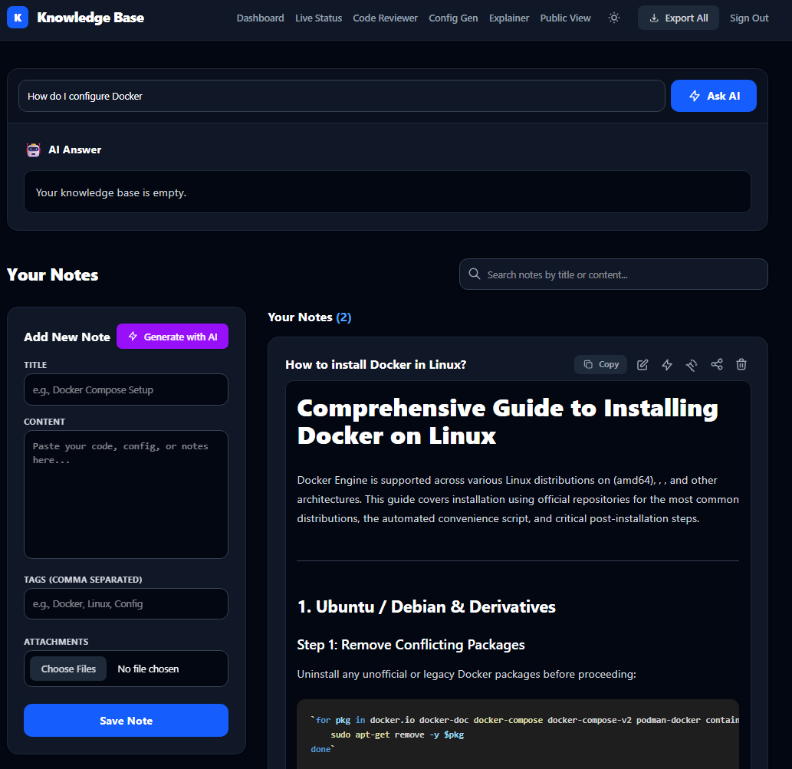
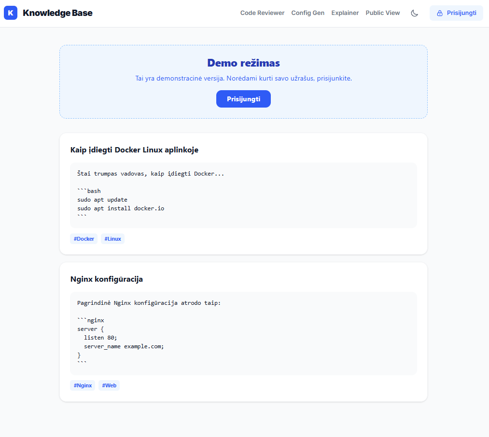

# 🧠 AI-Powered Knowledge Base

A personal, self-hosted knowledge base with AI capabilities, built with Next.js 16, Prisma, PostgreSQL, and Google Gemini.

This isn't just a note-taking app; it's a full-stack platform that reads, analyzes, and generates content using AI, protected by a multi-user Role-Based Access Control (RBAC) system and deployed via a self-hosted CI/CD pipeline.


## 📸 Screenshots




## ✨ Features

- **🌍 Full Internationalization (i18n):** Complete Lithuanian and English translation with `next-intl`. Automatic browser locale detection and a built-in language switcher.
- **🔐 Multi-User & Role-Based Access (RBAC):** Secure login via Google & GitHub. Admin-only routes for Docker/System management, and isolated personal notes for regular users.
- **🤖 Cloudflare Turnstile:** Bot protection on the login page, automatically localized to match the selected language.
- **👀 Read-Only Demo Mode:** Unauthenticated visitors can explore AI tools and public notes in a "read-only" state without consuming Gemini API quotas.
- **🛡️ Self-Service Account Deletion:** Users can permanently delete their account and all associated data (notes, files, history) directly from their profile page using a custom, styled confirmation modal. Data is securely wiped thanks to Prisma `onDelete: Cascade`.
- **📝 Markdown Notes:** Create, edit, and delete notes with a beautiful, responsive UI (Dark/Light mode).
- **🏷️ Tags & Search:** Organize notes with tags and search through titles, content, and tags.
- **⌨️ Command Palette (`Ctrl + K`):** A global, lightning-fast search modal to navigate your knowledge instantly.
- **🤖 AI Integrations (Google Gemini):**
  - **AI Summarize:** Generate bullet-point summaries of long notes.
  - **AI Improve:** Automatically fix grammar and format Markdown.
  - **AI Generate:** Create comprehensive notes from a single topic prompt.
  - **RAG Search:** Ask questions and get answers based _only_ on your own notes.
  - **AI Code Reviewer & Explainer:** Paste code to find bugs or get line-by-line explanations.
  - **AI Config Generator:** Generate production-ready Docker configs.
- **📎 File Attachments:** Upload images and PDFs.
  - **AI Image Analysis:** AI describes images and extracts text (OCR).
  - **AI PDF Analysis:** AI extracts and summarizes text from PDF documents.
  - **Public File Sharing:** Generate secure, shareable links for files.
- **⏱️ Rate Limiting:** All AI functions are protected by a rate limiter (5 requests per minute for most, 3 for note generation, 10 for RAG search) to prevent API abuse.
- **📜 Version History:** Every note edit creates a new version. Roll back to any previous state.
- **🌐 Public Portfolio:** A public-facing page (`/public`) to showcase your shared notes.
- **📊 Live Dashboard:** Monitor your Raspberry Pi's CPU, RAM, Uptime, and Docker containers in real-time (Admin only).
- **📱 Fully Responsive Navbar:** Optimized for mobile and desktop with a clean, animated hamburger menu.
- **🛡️ API Cost Protection:** Google Cloud Spend Cap integration and strict session-based validation to prevent API abuse.
- **🔍 SEO & AI Discoverability:** A-grade security headers (CSP, HSTS, etc.), `sitemap.xml`, `robots.txt`, `llms.txt`, and `ARD manifest` for AI agents.

## 🏗️ Architecture

This project is designed to run entirely on self-hosted hardware (specifically, a Raspberry Pi 5).

- **Frontend/Backend:** Next.js 16 (App Router, Server Actions, React 19, Route Groups).
- **Database:** PostgreSQL (via Docker) with Prisma ORM.
- **Auth:** NextAuth.js v5 (Auth.js) with Prisma Adapter and JWT strategy.
- **AI Engine:** Google Gemini (via `@google/genai`).
- **Deployment:** Docker Compose, managed by GitHub Actions (Self-hosted runner).
- **Networking:** Cloudflare Tunnels (zero open inbound ports).
- **File Storage:** Docker Bind Mounts for persistent local storage.
- **Error Handling:** Toast notifications via `sonner` for user-friendly error messages.
- **Code Editor:** Syntax highlighting and code completion via `@uiw/react-codemirror`.

## 🚀 Getting Started

### Prerequisites

- Node.js 22+
- Docker & Docker Compose
- A Google Gemini API Key
- Google & GitHub OAuth Credentials

### Environment Variables

Create a `.env` file in the root directory:

```env
# Database
DB_PASSWORD=your_secure_password

# AI
GEMINI_API_KEY=your_gemini_api_key

# Authentication
AUTH_SECRET=your_auth_secret
AUTH_URL=http://localhost:3000
AUTH_TRUST_HOST=true

# OAuth Providers
AUTH_GOOGLE_ID=your_google_client_id
AUTH_GOOGLE_SECRET=your_google_client_secret
AUTH_GITHUB_ID=your_github_client_id
AUTH_GITHUB_SECRET=your_github_client_secret
```

### Installation (Local Development)

1. **Clone the repository**
   Run this command in your terminal:
   `git clone https://github.com/adotbyte/knowledge-base.git`
   Then navigate into the folder:
   `cd knowledge-base`

2. **Install dependencies**
   Run:
   `npm install`

3. **Initialize the database (requires Docker)**
   Start the database container:
   `docker compose up -d db`
   Push the schema to the database:
   `npx prisma db push`

4. **Run the development server**
   Start the app:
   `npm run dev`

5. Open **http://localhost:3000** in your browser.

## 🐳 Deployment (Docker)

To run the full production stack (Database + Web + Cloudflare Tunnel), run:
`docker compose up -d --build`

## 🧪 Testing

This project uses **Vitest** for unit testing. Run:
`npm run test`

## 👨‍💻 Author

**Audrius Morkūnas**

- [Portfolio](https://morkunas.info)
- [Live Knowledge Base](https://knowledge.morkunas.info/demo)

## 📄 License

This project is licensed under the MIT License.
