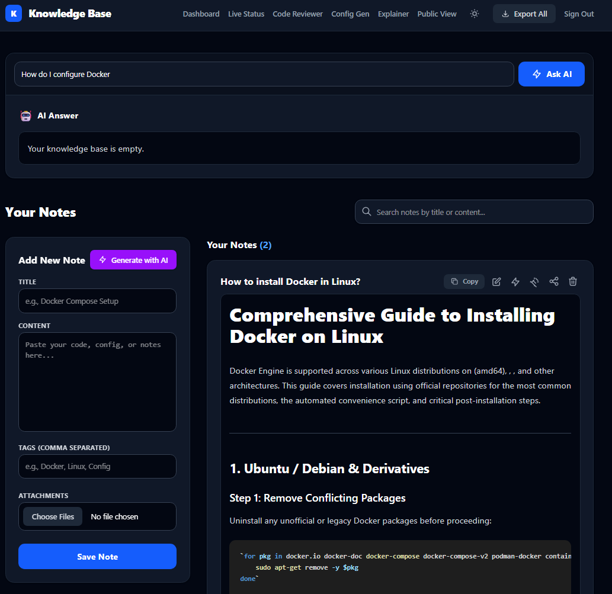
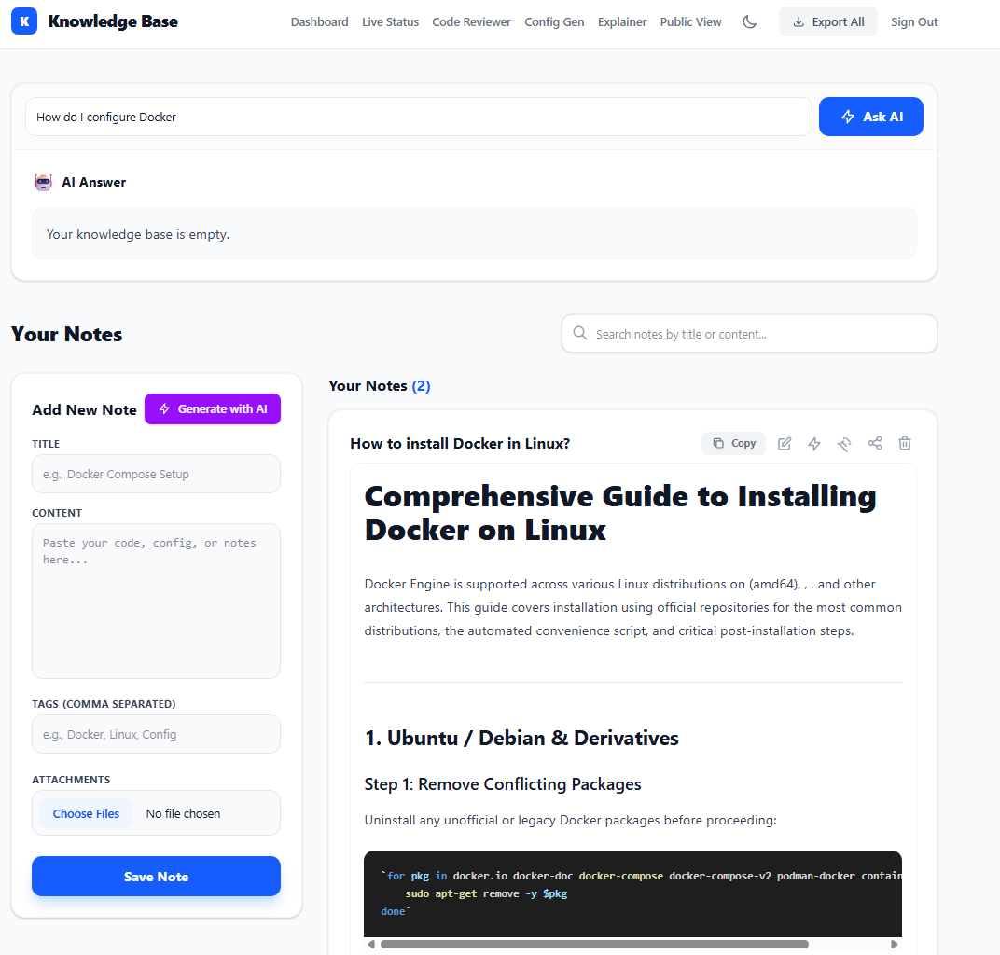

# 🧠 AI-Powered Knowledge Base

A personal, self-hosted knowledge base with AI capabilities, built with Next.js 16, Prisma, PostgreSQL, and Google Gemini.

This isn't just a note-taking app; it's a full-stack platform that reads, analyzes, and generates content using AI, protected by Cloudflare Zero Trust and deployed via a self-hosted CI/CD pipeline.


## 📸 Screenshots




## ✨ Features

- **📝 Markdown Notes:** Create, edit, and delete notes with a beautiful, responsive UI (Dark/Light mode).
- **🏷️ Tags & Search:** Organize notes with tags and search through titles, content, and tags.
- **⌨️ Command Palette (`Ctrl + K`):** A global, lightning-fast search modal to navigate your knowledge instantly.
- **🤖 AI Integrations (Google Gemini):**
  - **AI Summarize:** Generate bullet-point summaries of long notes.
  - **AI Improve:** Automatically fix grammar and format Markdown.
  - **AI Generate:** Create comprehensive notes from a single topic prompt.
  - **RAG Search:** Ask questions and get answers based _only_ on your own notes.
  - **AI Code Reviewer & Explainer:** Paste code to find bugs or get line-by-line explanations.
  - **AI Config Generator:** Generate production-ready Docker configs.
- **📎 File Attachments:** Upload images and PDFs.
  - **AI Image Analysis:** AI describes images and extracts text (OCR).
  - **AI PDF Analysis:** AI extracts and summarizes text from PDF documents.
  - **Public File Sharing:** Generate secure, shareable links for files.
- **📜 Version History:** Every note edit creates a new version. Roll back to any previous state.
- **🌐 Public Portfolio:** A public-facing page (`/public`) to showcase your shared notes.
- **📊 Live Dashboard:** Monitor your Raspberry Pi's CPU, RAM, Uptime, and Docker containers in real-time.
- **🔒 Security:** Protected by Cloudflare Zero Trust (Access) and Turnstile.

## 🏗️ Architecture

This project is designed to run entirely on self-hosted hardware (specifically, a Raspberry Pi 5).

- **Frontend/Backend:** Next.js 16 (App Router, Server Actions, React 19).
- **Database:** PostgreSQL (via Docker) with Prisma ORM.
- **AI Engine:** Google Gemini (via `@google/genai`).
- **Deployment:** Docker Compose, managed by GitHub Actions (Self-hosted runner).
- **Networking:** Cloudflare Tunnels (zero open inbound ports) and Zero Trust Access.
- **File Storage:** Docker Bind Mounts for persistent local storage.

## 🚀 Getting Started

### Prerequisites

- Node.js 22+
- Docker & Docker Compose
- A Google Gemini API Key

### Environment Variables

Create a `.env` file in the root directory:

```env
# Database
DB_PASSWORD=your_secure_password

# AI
GEMINI_API_KEY=your_gemini_api_key

# Auth / Security (For local dev or Cloudflare bypass)
AUTH_SECRET=your_auth_secret
AUTH_TRUST_HOST=true
```

### Installation (Local Development)

1. **Clone the repository**
   Run this command in your terminal:
   `git clone https://github.com/adotbyte/knowledge-base.git`
   Then navigate into the folder:
   `cd knowledge-base`

2. **Install dependencies**
   Run:
   `npm install`

3. **Initialize the database (requires Docker)**
   Start the database container:
   `docker compose up -d db`
   Push the schema to the database:
   `npx prisma db push`

4. **Run the development server**
   Start the app:
   `npm run dev`

5. Open **http://localhost:3000** in your browser.

## 🐳 Deployment (Docker)

To run the full production stack (Database + Web + Cloudflare Tunnel), run:
`docker compose up -d --build`

## 🧪 Testing

This project uses **Vitest** for unit testing. Run:
`npm run test`

## 👨‍💻 Author

**Audrius Morkūnas**

- [Portfolio](https://morkunas.info)
- [Live Knowledge Base](https://knowledge.morkunas.info/public)

## 📄 License

This project is licensed under the MIT License.
